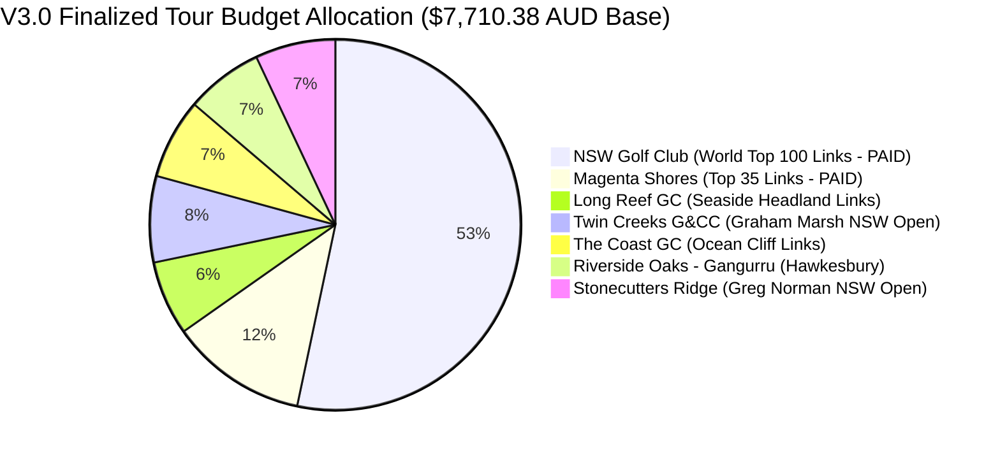

# ⛳ Sydney Golf 2026–2027: Strategic Advisory & V3.0 Smart-Luxury Roster

**Author:** Senior Sydney Golf Strategic Advisor & Cost Optimization Specialist  
**Target Group:** 4-Ball Team (Han Jaehoon H.I. `9.3`, Lim Cheonsoo H.I. `1.0`, Kim Jaechun H.I. `3.2`, Yang Chunkeum H.I. `1.9`)  
**Host & Coordinator:** Won Gue Kim (North Ryde Base: 27A Michael St, North Ryde NSW 2113)  
**Tour Dates:** 26 December 2026 (Sat) – 2 January 2027 (Sat) [7 Nights / 8 Days]  
**Master Google Doc SSOT:** [Sydney Golf & Tour Master Itinerary (V3.0)](https://docs.google.com/document/d/1-n3gonr1VTphtwbnRMrh_3xuUNk0zVgABavcoluEM4s/edit?tab=t.0)  
**Last Updated:** 16 November 2026

---

## Executive Summary: V3.0 Quality-Value Optimization

The 2026–2027 Sydney Golf Tour has been finalized around the **Quality Club Rule (Codified 2026-11-16)**:
- **Target Sweet Spot (`~$120–$350/pp`):** Prioritize memorable championship, ocean-cliff, and tournament-pedigree clubs worthy of visiting Korean golfers.
- **No Budget/Suburban-Filler Clubs:** `Muirfield`, `Lynwood`, `North Ryde`, and `Macquarie Links` have been **purged**.
- **No Overpriced Overseas-Tariff Traps (`$500–$750+/pp`):** `Terrey Hills` (`WKIM001`, `$2,750` / `$687.50 pp`) was **formally released** and `The Lakes` excluded, redirecting **`$2,050.00 AUD`** (~₩1,845,000 KRW) in savings without sacrificing course pedigree.

---

## Part 1: Finalized V3.0 Championship Roster & Quality Plan-B Matrix

| Day / Date | Primary Course | Pedigree & Slope | Target Tee Time | Price / Player | Status | Quality Plan-B (No Budget Fillers) |
| :--- | :--- | :--- | :---: | :---: | :--- | :--- |
| **Day 1** Sat 26 Dec | **Long Reef GC** *(Collaroy Headland)* | Eric Apperly & Dan Soutar Top 80 Aus, Slope 128 | `14:00–14:15` | **~$125.00** (incl. cart) | 🟡 **Inquiry Sent (16 Nov)** Opens `28 Nov @ 07:00` | **Mona Vale GC** (`~$125/pp`) or **St. Michael's** (`15:00+`) |
| **Day 2** Sun 27 Dec | **Stonecutters Ridge** *(Western Sydney)* | Greg Norman & Bob Harrison NSW Open Host, Slope 138 | `Afternoon` | **$105–$135** (incl. cart) | 🟡 **Inquiry Sent (16 Nov)** Leftovers `21 Dec @ 09:30` | **St. Michael's** (`12:00+` PM) or **Riverside Oaks (Gangurru)** |
| **Day 3** Mon 28 Dec | **Magenta Shores** *(Central Coast)* | Ross Watson Top 35 Links, Slope 140 | `07:30 AM` | **$230.00** ($200 + $30 cart) | 🟢 **100% PAID & VERIFIED** `WPAHYQBR-0001` / `2637-6526` | *Locked & Paid* |
| **Day 4** Tue 29 Dec | **New South Wales GC** *(La Perouse)* | Dr. Alister MacKenzie World #33 / Aus #5 | `11:09 AM` | **$1,027.60** | 🟢 **100% PAID & VERIFIED** Ref: `NSW-53ZR560E` | *Locked & Paid* |
| **Day 5** Wed 30 Dec | **Riverside Oaks** *(Gangurru Course)* | Former NSW Open Host Hawkesbury Resort | `07:00–08:00` | **~$105–$130** (incl. cart) | 🟠 **Unbooked** Opens `09 Dec @ 07:00` | **Stonecutters Ridge** or **Twin Creeks G&CC** |
| **Day 6** Thu 31 Dec | **The Coast GC** *(Little Bay)* | Ocean Cliff Links *Dramatic Pacific Views* | `07:00–08:00` | **~$135** *(Local)* **$230** *(Intl)* | 🟠 **Unbooked** Opens `24 Dec @ 07:00` *(Non-AMEX)* | **2nd Option:** **St. Michael's GC** (`~$170–$275/pp`, `23 Dec @ 16:00`) |
| **Day 7** Fri 01 Jan | **Twin Creeks G&CC** *(Luddenham)* | Graham Marsh (2006) NSW Open Host, Slope 136 | `08:30–09:00` | **$145.00** (incl. cart) | 🟠 **Unbooked** Opens `18 Dec @ 05:00` | **Stonecutters Ridge** or **Riverside Oaks (Gangurru)** |

### Budget Summary
- **Already Paid (`🟢`):** `$5,030.38 AUD` (NSW GC `$4,110.38` + Magenta Shores `$920.00`)
- **Remaining 5 Rounds Estimate (`🟡`/`🟠`):** `~$2,680.00 AUD` (Base) — up to `~$3,060.00 AUD` if The Coast international visitor rate (`$230/pp`) applies.
- **Total 7-Round Budget:** **`$7,710.38 AUD`** base (`$8,090.38 AUD` worst-case buffer) — **`-$2,050.00 AUD` saved** vs. the initial `$9,760.38 AUD` baseline.

---

## Part 2: Why This Mix Works for Visiting Korean Golfers

1. **4 Pure Coastal / Ocean-View Experiences:** NSW Golf Club (World Top 100 clifftop), Magenta Shores (coastal dunes), Long Reef (peninsula ocean views on every hole), and The Coast / St. Michael's (Little Bay cliffside links).
2. **Authentic Australian Championship Pedigree:** Twin Creeks delivers **Graham Marsh's** championship DNA (same architect as Terrey Hills) at ~21% of Terrey Hills' overseas tariff, while Stonecutters Ridge showcases **Greg Norman's** dramatic serrated bunkering.
3. **Zero Filler Rounds:** Every single day features either a Top-100 ranked links, an ocean-cliff course, or a former NSW Open championship venue.

---

## Part 3: Practical Guide for Visiting Korean Golfers

### 3.1 Cultural & Etiquette Differences: Korea vs. Australia

| Aspect | Korean Golf Culture (한국 골프 문화) | Australian Golf Realities (호주 골프 문화) | Operational Action for 4-Ball Team |
| :--- | :--- | :--- | :--- |
| **Caddies & Pacing** | Mandatory caddie manages clubs, yardages, putts, and cart driving. | **Self-guided & Unassisted.** | Use GPS watch / rangefinders; practice "Ready Golf" to maintain a **sub-4-hour round**. |
| **Carts & Fairways** | Carts strictly on paved cart paths. | **90-Degree Rule / Fairway Access** permitted on most courses (weather permitting). | Drive directly to the ball across fairways (except greens & teebox collars); saves leg fatigue. |
| **Pace of Play** | Caddie regulates pace. 4h 30m – 5h standard. | Strict club marshals enforce **3h 45m – 4h 00m**. | Continuous putting, play provisional balls for bush lies, pick up when out of strokes. |
| **Half-Way House** | 20–30 min relaxed break at the turn. | **Quick 5-minute Turn.** Grab a snack/drink from Pro Shop / Cart Bar. | No long mid-round dining break. Keep momentum going into Hole 10. |
| **Tipping** | Fixed mandatory caddie fee. | **No Tipping Expected.** | Australian green fees and cart hires are fully inclusive. |
| **Dress Code** | Flashy designer golf wear common. | Traditional golf attire strictly enforced (collared shirts, tailored shorts with sports socks, soft spikes). | Metal spikes banned. No denim, cargo shorts, or collarless t-shirts. |

### 3.2 Physical, Heat & Logistics Defense Checklist
1. **Extreme Summer UV (Index 11–13+):** Stock **SPF 50+ sunscreen**, UV hats, and ice towels; reapply at Hole 10.
2. **Hydration & Electrolytes:** Supply 2.0L–2.5L of water/electrolytes per golfer per round.
3. **NSW GC Cart Verification (`NSW-53ZR560E`):** Booked as a motorized cart round; verify receipt cart terms prior to arrival.
4. **Vehicle Requirement:** Strictly **8-seat `2-3-3` bench** (Kia Carnival / Hyundai Staria) with 3rd row folded flat for 5 pax + 4 golf bags + 4 large suitcases.

---

## Part 4: Active Booking Window Roadmap (Nov – Dec 2026)

| Step | Action | Trigger Date (AEDT) | Channel / Contact |
| :---: | :--- | :--- | :--- |
| **1** | **Book Day 1 — Long Reef GC** (`14:00–14:15` + 2 carts) | **Sat 28 Nov 2026 @ 07:00** | MiClub (`longreefgolfclub.com.au`) / `(02) 9982 2943` |
| **2** | **Book Day 5 — Riverside Oaks (Gangurru)** (`07:00–08:00` + 2 carts) | **Wed 09 Dec 2026 @ 07:00** | MiClub online (backup call Wed 16 Dec `(02) 4560 3200`) |
| **3** | **Book Day 7 — Twin Creeks G&CC** (`08:30–09:00` + 2 carts) | **Fri 18 Dec 2026 @ 05:00** | Online / `(02) 9670 8888` (backup check Wed 16 Dec @ 05:00) |
| **4** | **Lock Day 2 — Stonecutters Ridge** (Earliest PM `12:00–12:30`) | **Mon 21 Dec 2026 @ 09:30** | Post-ballot leftover release / `(02) 9627 1816` *(Plan-B: St. Michael's opens 19 Dec @ 16:00)* |
| **5** | **Book Day 6 — The Coast GC** (`07:00–08:00` + 2 carts, **Non-AMEX**) | **Thu 24 Dec 2026 @ 07:00** | MiClub / `(02) 9311 7422` *(2nd Option St. Michael's opens Wed 23 Dec @ 16:00)* |
